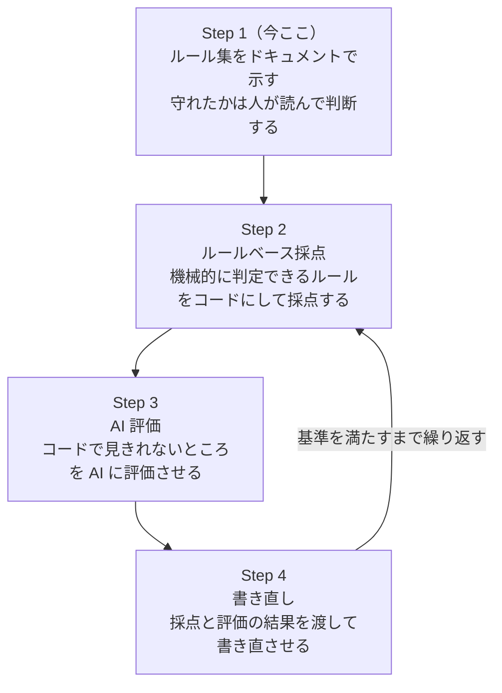

# docs-rules

## ディレクトリ構成

```
.
├── skills/
│   └── docs-rules/
│       ├── SKILL.md
│       ├── rules/          # Markdown記法、文体、表記などの共通ルール
│       ├── schemas/        # 必須セクションや文書構造の定義
│       ├── templates/      # 用途別の文書テンプレート
│       ├── prompts/        # 生成・評価・修正に使用するプロンプト
│       └── evaluators/     # コードおよびAIによる評価処理
└── tests/                  # 期待する生成例と回帰テスト
```

## インストール

3通りあります。

### 1. 手動配置

クローンして、スキルディレクトリに置きます。

```bash
git clone https://github.com/knk1313/docs-rules.git
cp -r docs-rules/skills/docs-rules ~/.claude/skills/docs-rules
```

Claude Code を再起動すると読み込まれます。

### 2. `npx skills add`

GitHub から直接入れます。

```bash
npx skills add knk1313/docs-rules
```

### 3. Claude Code プラグイン

Claude Code のセッション内で実行します。

```
/plugin marketplace add knk1313/docs-rules
/plugin install docs-rules@docs-rules
```

## ロードマップ

