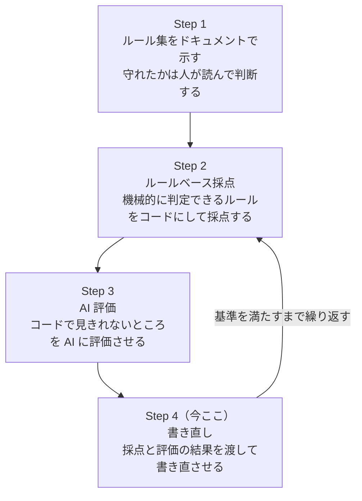

# docs-rules

[](https://github.com/knk1313/docs-rules/actions/workflows/ci.yml)
[](https://github.com/knk1313/docs-rules/releases)
[](LICENSE)
[](https://github.com/knk1313/docs-rules/stargazers)

日本語の文書を、共通の表記・文体ルールと文書種別ごとの構成に沿って書くためのClaude Codeスキルです。

## 何をするか

スキルを入れると、Claude Codeは日本語の文書を書く前に次の三つを読み、書き終えた後に自分で点検します。

| 読むもの | 内容 | 例 |
| --- | --- | --- |
| `rules/` | 全文書に共通する禁止語、文法・文体、表記、Markdown記法、アクセシビリティのルールで、ルールごとにIDと出典を付けている | 「〜することができる」を使わない、常体と敬体を混ぜない、見出しの階層を1段ずつ下げる |
| `schemas/` | 文書種別ごとの必須セクションと構造 | セッションログは「決めたこと」「決めた理由」「未解決の課題」を必ず持つ |
| `templates/` | 文書種別ごとの見出しの型 | 提案書は「決めてほしいこと」を先頭に置き、「選択肢と比較」「推奨案と理由」の順で続ける |

対応する文書種別は、次の九つです。どれにも当たらない文書には、共通ルールだけを適用します。

- セッションログ（`session-log`）
- 提案書（`proposal`）
- 学会論文（`journal-paper`）
- 学位論文（`thesis`）
- UI文言（`ui-text`）
- ハウツー（`how-to`）
- チュートリアル（`tutorial`）
- リファレンス（`reference`）
- 解説（`explanation`）

## 誰向けか

AIを使って日本語の文書を繰り返し作る人と組織です。生成のたびに見出し、表記、文章量が変わり、人が読んで直す手間が生じています。ルールを共通の資産にし、この手間を減らします。ルールは公用文作成の考え方やJTF日本語標準スタイルガイドなどの公開資料を出典にしているので、自分の基準を一から書く必要はありません。

## インストール

Claude Codeでは3通りあります。claude.aiで使う場合は、4のとおりzipをアップロードします。

### 1. 手動配置

クローンして、スキルディレクトリに置きます。

```bash
git clone https://github.com/knk1313/docs-rules.git
mkdir -p ~/.claude/skills
cp -r docs-rules/skills/docs-rules ~/.claude/skills/docs-rules
cp -r docs-rules/skills/docs-rules-feedback ~/.claude/skills/docs-rules-feedback
```

`docs-rules-feedback`は、改善点をIssueにするためのスキルです。使わない場合は、2行目のコピーを省けます。

Claude Codeは、再起動時にこのスキルを読み込みます。

### 2. `npx skills add`

GitHubから直接入れます。

```bash
npx skills add knk1313/docs-rules
```

### 3. Claude Codeプラグイン

Claude Codeのセッション内で実行します。

```text
/plugin marketplace add knk1313/docs-rules
/plugin install docs-rules@docs-rules
```

### 4. claude.aiへのアップロード

[Releases](https://github.com/knk1313/docs-rules/releases)から`docs-rules-vX.Y.Z.zip`を取得し、claude.aiのスキルの設定でアップロードします。新しい版を使うときは、新しい版のzipをアップロードし直します。zipは、リリースを公開したときにGitHub Actionsが作ります。zipには`docs-rules-feedback`を入れていません。claude.aiでは改善点をファイルにためられないため、報告に出た改善点の候補を、手でIssueに写してください。

## 使い方

インストールしたうえで、Claude Codeのセッションで日本語の文書を頼みます。

```text
今日の作業をセッションログにまとめて
```

```text
この調査結果を提案書の形にして
```

既存の文書を直すこともできます。プラグインとして入れた場合は、スラッシュコマンドで明示的に呼べます。

```text
/docs-rules:docs-rules README.mdを校正して
```

文書の点検で、ルールや採点の不備に気付くことがあります。気付いた不備は「改善点の候補」として報告され、手元のファイルにためられます。たまった候補は、次のように頼むとIssueの下書きになります。下書きを確かめて承認したものだけが、Issueとして出ます。

```text
docs-rulesの改善点をIssueにして
```

ルールの一覧は[skills/docs-rules/rules/](skills/docs-rules/rules/)に、どのファイルをどの順に読むかは[skills/docs-rules/SKILL.md](skills/docs-rules/SKILL.md)にあります。Claude Codeがスキルを読み込んでから文書を出すまでの流れは、[docs/architecture.md](docs/architecture.md)に図で示しています。

## 動作環境

- Claude Codeで動作を確かめています。スキルの本体はMarkdownだけなので、`SKILL.md`の形式を読める他のエージェントでも読めます。Claude Code以外では確かめていません
- 書き終えた文書の機械判定（`evaluators/score.mjs`）には、Node.js 18以上とnpmが要ります。ない環境では機械判定を飛ばし、AIの自己点検だけで仕上げます
- 機械判定は、初回の実行でtextlintとmarkdownlint-cli2をnpmから取得し、利用者のキャッシュ（macOSは`~/Library/Caches/docs-rules`）に入れます。版は`package-lock.json`で依存の依存まで固定し、インストール時のスクリプトは動かしません。詳しくは[evaluators/README.md](skills/docs-rules/evaluators/README.md)の「パッケージの入れ方」を参照してください
- `evaluators/data/tools/`のスクリプトを動かすにはPython 3が要ります。スキルとして使うだけなら不要です

## For English readers

docs-rules is a Claude Code skill for writing Japanese documents to a consistent standard. It ships a rule set (forbidden phrases, grammar and style, notation, Markdown syntax, accessibility) with an ID and a cited source for every rule, plus schemas and templates for document types such as session logs and proposals. The rules are rewritten in our own words from public sources, mainly the Japanese Agency for Cultural Affairs' guidance on official documents, the JTF Japanese Standard Style Guide, Cabinet notifications on kanji and kana usage, the CommonMark Spec, and markdownlint. Install it with `npx skills add knk1313/docs-rules` or as a Claude Code plugin, then ask Claude Code for a Japanese document. The rest of this README is in Japanese.

## ディレクトリ構成

現状のリポジトリに実在するファイルとディレクトリです。これから作るものは、[ロードマップ](#ロードマップ)の「目指す構成」に載せています。

```text
docs-rules/
├── .claude-plugin/         # Claude Codeプラグインとマーケットプレイスのマニフェスト
├── .github/                # IssueとPRのテンプレート、GitHub Actionsのワークフロー、Dependabotの設定
├── ci/                     # CIのプラグインの検証で使うClaude Codeの版
├── docs/                   # アーキテクチャの図、価値仮説、価値提案キャンバス
├── skills/
│   ├── docs-rules/
│   │   ├── SKILL.md
│   │   ├── references/     # ルールの出典となる資料の一覧
│   │   ├── rules/          # 文体、表記、構成、Markdown記法の共通ルール
│   │   ├── schemas/        # 必須セクションや文書構造の定義
│   │   ├── templates/      # 用途別の文書テンプレート
│   │   ├── prompts/        # AI評価の手順（evaluate.md）と書き直しの手順（rewrite.md）
│   │   └── evaluators/     # 採点の入口（score.mjs）、書き直しの前後の比較（compare.mjs）、textlintとmarkdownlintの設定、prh辞書、判定データ（内閣告示のJSON）、文書種別ごとの判定（schema-checks/）
│   └── docs-rules-feedback/
│       ├── SKILL.md        # 改善点の候補をIssueにする手順
│       └── scripts/        # 改善点の候補をためる（feedback.mjs）
├── tests/                  # リポジトリの構成を確かめるテスト（SKILL.mdの大きさ、rules・schemas・templatesの整合、Markdownの採点）
├── AGENTS.md               # AIエージェント向けの禁止事項と規約
├── CLAUDE.md               # Claude Code用の入口（AGENTS.mdを読み込む）
├── CODE_OF_CONDUCT.md      # 行動規範（Contributor Covenant 2.0 を基にしたもの）
├── CONTRIBUTING.md         # IssueとPRの出し方
├── LICENSE
├── README.md
└── SECURITY.md             # 脆弱性の報告先と対応の方針
```

Issueを完了してファイルやディレクトリが増減したときは、そのPRでこのツリーも更新します。

## バージョン管理

[Semantic Versioning 2.0.0](https://semver.org/lang/ja/)に従い、`vX.Y.Z`の形のgitタグで版を示します。タグはgitだけに置き、`plugin.json`にはバージョンを書きません。

変更の内容ごとに、上げる桁は次のとおりです。

| 上げる桁 | 変更の内容 |
| --- | --- |
| X（メジャー） | 既存のルールIDの削除や意味の変更、`schemas/`の必須セクションの削除、インストール方法の変更など、利用者が書いた文書や設定を見直す必要がある変更 |
| Y（マイナー） | ルール、文書種別、スキーマ、テンプレートの追加など、既存の利用者がそのまま使える変更 |
| Z（パッチ） | 誤字や説明の修正、ルールの意味を変えない例の追加 |

- `1.0.0`は、ロードマップのStep 4までそろった時点で付けます。それまでは`0.Y.Z`で、マイナーの変更にもルールIDの削除や意味の変更を含めることがあります
- 変更点は[Releases](https://github.com/knk1313/docs-rules/releases)に書きます。`CHANGELOG.md`は置きません
- `main`は常にタグより新しいことがあります。特定の版を使うときは、タグを指定してクローンしてください

```bash
git clone --branch v0.1.0 --depth 1 https://github.com/knk1313/docs-rules.git
```

リリースの手順は[CONTRIBUTING.md](CONTRIBUTING.md)の「リリース」を参照してください。

## ロードマップ



### 目指す構成

Step 4までそろったときのディレクトリ構成です。現状の構成は[ディレクトリ構成](#ディレクトリ構成)を参照してください。

```text
docs-rules/
├── skills/
│   └── docs-rules/
│       ├── SKILL.md
│       ├── references/     # ルールの出典となる資料の一覧
│       ├── rules/          # Markdown記法、文体、表記などの共通ルール
│       ├── schemas/        # 必須セクションや文書構造の定義
│       ├── templates/      # 用途別の文書テンプレート
│       ├── prompts/        # 生成・評価・修正に使用するプロンプト
│       └── evaluators/     # コードおよびAIによる評価処理
└── tests/                  # 期待する生成例と回帰テスト
```

## 利用条件

本リポジトリはMITライセンスで公開しています。全文は[LICENSE](LICENSE)を参照してください。文書とコードでライセンスを分けていません。

ただし、`skills/docs-rules/rules/`と`skills/docs-rules/schemas/`の一部は、次の資料を基に編集・加工したものです。各ルールの「出典」欄に、資料名と該当箇所を書いています。

| 資料 | 資料の利用条件 | 本リポジトリでの扱い |
| --- | --- | --- |
| [公用文作成の考え方](https://www.bunka.go.jp/koho_hodo_oshirase/hodohappyo/93650001.html)（文化審議会建議、令和4年1月7日） | [文部科学省ウェブサイト利用規約](https://www.mext.go.jp/b_menu/1351168.htm)（CC BY 4.0互換） | 文化庁の資料を基に、自分の文章で書き直して編集・加工しています |
| [JTF日本語標準スタイルガイド](https://www.jtf.jp/tips/styleguide)第4.0版（日本翻訳連盟） | CC BY 4.0 | 自分の文章で書き直して編集・加工しています |
| 常用漢字表・送り仮名の付け方・外来語の表記（内閣告示） | 著作権法第13条により、権利の目的となりません | 告示の内容を、表記ルールの根拠と判定データに使います |
| [Google Developer Documentation Style Guide](https://developers.google.com/style)（AccessibilityとDates and timesの章） | CC BY 4.0 | 自分の文章で日本語に書き直して編集・加工しています |
| [政府相互運用性フレームワーク（GIF）](https://www.digital.go.jp/policies/data_strategy_government_interoperability_framework)DS-441『コアデータパーツ 日付及び時刻』（デジタル庁） | 公共データ利用規約（PDL1.0、CC BY 4.0互換）。配布ファイルはCC0 1.0 | デジタル庁の資料を基に、自分の文章で書き直して編集・加工しています |
| [在留支援のためのやさしい日本語ガイドライン](https://www.moj.go.jp/isa/content/930006072.pdf)（出入国在留管理庁・文化庁） | 公共データ利用規約（PDL1.0、CC BY 4.0互換） | 出入国在留管理庁と文化庁の資料を基に、自分の文章で書き直して編集・加工しています |
| [デジタル庁デザインシステム](https://design.digital.go.jp/dads/)（入力フィールド、ボタン、ディスクロージャー、緊急時バナー、リンクテキストのページ） | 公共データ利用規約（PDL1.0、CC BY 4.0互換） | デジタル庁の資料を基に、自分の文章で書き直して編集・加工しています。UI文言（`schemas/ui-text.md`）とMKD-010に使います |
| [GOV.UK Service Manual](https://www.gov.uk/service-manual/design/writing-for-user-interfaces)と[GOV.UK Design System](https://design-system.service.gov.uk/components/error-message)（Writing for user interfaces、Error message） | [Open Government Licence v3.0](https://www.nationalarchives.gov.uk/doc/open-government-licence/version/3/) | Contains public sector information licensed under the Open Government Licence v3.0. 考え方を自分の文章で日本語に書き直し、UI文言（`schemas/ui-text.md`）に使います |

- 上の資料の作成元は、本リポジトリの作成や内容に関わっていません。本リポジトリのルールは、作成元の見解を示すものではありません
- 今後`rules/`に取り込む資料は、[references/reference-sources.md](skills/docs-rules/references/reference-sources.md)のライセンス欄に従い、出典の表示を保ちます
- CC BY-SA 4.0の資料（CommonMark Spec、Diátaxis）は、考え方の参照にとどめ、文章をリポジトリに置きません
