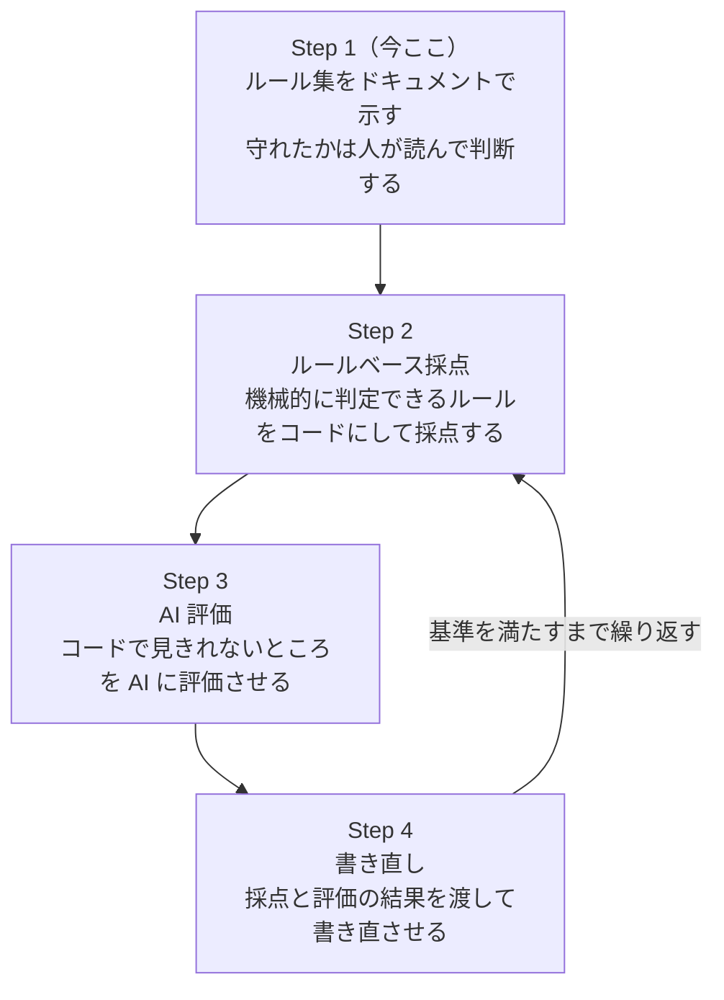

# docs-rules

## ディレクトリ構成

現状のリポジトリに実在するファイルとディレクトリです。これから作るものは、[ロードマップ](#ロードマップ)の「目指す構成」に載せています。

```text
docs-rules/
├── .claude-plugin/         # Claude Code プラグインとマーケットプレイスのマニフェスト
├── .github/                # Issue と PR のテンプレート、GitHub Actions のワークフロー
├── docs/                   # 価値仮説、価値提案キャンバス、textlintの使い方の決定
├── skills/
│   └── docs-rules/
│       ├── SKILL.md
│       ├── references/     # ルールの出典となる資料の一覧
│       ├── rules/          # 文体、表記などの共通ルール
│       ├── schemas/        # 必須セクションや文書構造の定義
│       ├── templates/      # 用途別の文書テンプレート
│       └── evaluators/     # 判定データ（内閣告示の JSON）。採点の入口は Step 2 で足す
├── AGENTS.md               # AI エージェント向けの禁止事項と規約
├── CLAUDE.md               # Claude Code 用の入口（AGENTS.md を読み込む）
├── CODE_OF_CONDUCT.md      # 行動規範（Contributor Covenant 2.0 を基にしたもの）
├── CONTRIBUTING.md         # Issue と PR の出し方
├── LICENSE
└── README.md
```

Issueを完了してファイルやディレクトリが増減したときは、そのPRでこのツリーも更新します。

## インストール

3通りあります。

### 1. 手動配置

クローンして、スキルディレクトリに置きます。

```bash
git clone https://github.com/knk1313/docs-rules.git
cp -r docs-rules/skills/docs-rules ~/.claude/skills/docs-rules
```

Claude Codeを再起動すると読み込まれます。

### 2. `npx skills add`

GitHubから直接入れます。

```bash
npx skills add knk1313/docs-rules
```

### 3. Claude Codeプラグイン

Claude Codeのセッション内で実行します。

```
/plugin marketplace add knk1313/docs-rules
/plugin install docs-rules@docs-rules
```

## バージョン管理

[Semantic Versioning 2.0.0](https://semver.org/lang/ja/)に従い、`vX.Y.Z`の形のgitタグで版を示します。タグはgitだけに置き、`plugin.json`にはバージョンを書きません。

| 上げる桁 | 変更の内容 |
| --- | --- |
| X（メジャー） | 既存のルールIDの削除や意味の変更、`schemas/`の必須セクションの削除、インストール方法の変更。利用者が書いた文書や設定を見直す必要がある変更 |
| Y（マイナー） | ルール、文書種別、スキーマ、テンプレートの追加。既存の利用者はそのまま使える変更 |
| Z（パッチ） | 誤字や説明の修正、ルールの意味を変えない例の追加 |

- `1.0.0`は、ロードマップのStep 4までそろった時点で付けます。それまでは`0.Y.Z`で、マイナーの変更でもルールIDの削除や意味の変更が入ることがあります
- 変更点は[Releases](https://github.com/knk1313/docs-rules/releases)に書きます。`CHANGELOG.md`は置きません
- `main`は常にタグより新しいことがあります。特定の版を使うときは、タグを指定してクローンしてください

```bash
git clone --branch v0.1.0 --depth 1 https://github.com/knk1313/docs-rules.git
```

リリースの手順は[CONTRIBUTING.md](CONTRIBUTING.md)の「リリース」を参照してください。

## ロードマップ



### 目指す構成

Step 4までそろったときのディレクトリ構成です。現状の構成は[ディレクトリ構成](#ディレクトリ構成)を参照してください。

```text
docs-rules/
├── skills/
│   └── docs-rules/
│       ├── SKILL.md
│       ├── references/     # ルールの出典となる資料の一覧
│       ├── rules/          # Markdown記法、文体、表記などの共通ルール
│       ├── schemas/        # 必須セクションや文書構造の定義
│       ├── templates/      # 用途別の文書テンプレート
│       ├── prompts/        # 生成・評価・修正に使用するプロンプト
│       └── evaluators/     # コードおよびAIによる評価処理
└── tests/                  # 期待する生成例と回帰テスト
```

## 利用条件

本リポジトリはMITライセンスで公開しています。全文は[LICENSE](LICENSE)を参照してください。文書とコードでライセンスを分けていません。

ただし、`skills/docs-rules/rules/`の一部は、次の資料を基に編集・加工したものです。各ルールの「出典」欄に、資料名と該当箇所を書いています。

| 資料 | 資料の利用条件 | 本リポジトリでの扱い |
| --- | --- | --- |
| [公用文作成の考え方](https://www.bunka.go.jp/koho_hodo_oshirase/hodohappyo/93650001.html)（文化審議会建議、令和4年1月7日） | [文部科学省ウェブサイト利用規約](https://www.mext.go.jp/b_menu/1351168.htm)（CC BY 4.0互換） | 文化庁の資料を基に、自分の文章で書き直して編集・加工しています |
| [JTF日本語標準スタイルガイド](https://www.jtf.jp/tips/styleguide)第4.0版（日本翻訳連盟） | CC BY 4.0 | 自分の文章で書き直して編集・加工しています |
| 常用漢字表・送り仮名の付け方・外来語の表記（内閣告示） | 著作権法第13条により、権利の目的となりません | 告示の内容を、表記ルールの根拠と判定データに使います |

- 上の資料の作成元は、本リポジトリの作成や内容に関わっていません。本リポジトリのルールは、作成元の見解を示すものではありません
- 今後`rules/`に取り込む資料は、[references/reference-sources.md](skills/docs-rules/references/reference-sources.md)のライセンス欄に従い、出典の表示を保ちます
- CC BY-SA 4.0の資料（CommonMark Spec、Diátaxis）は、考え方の参照にとどめ、文章をリポジトリに置きません
