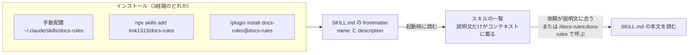
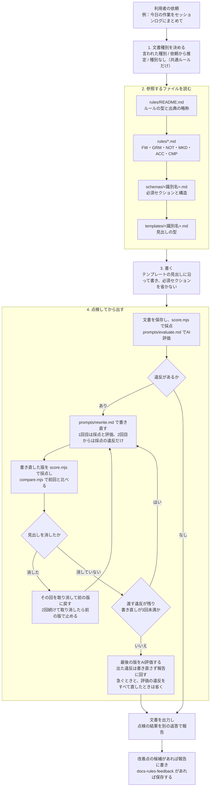
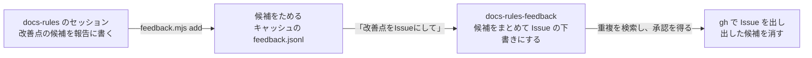

# docs-rulesのアーキテクチャ

Claude Codeがdocs-rulesのスキルをどう読み込み、一つの文書を書くときに何をどの順で使うかを図で示す。

## 1. 配布からスキルの起動まで

## 2. 文書を書く流れ

- 採点（`score.mjs`）は、textlint、markdownlint、種別ごとの判定（`evaluators/schema-checks/`）をまとめて動かし、指摘をルールIDに対応させて返す。textlintには、プリセットのルール、prh辞書、`evaluators/custom-rules/`の自前のルールを読み込む
- 採点の検出率と誤検出は、`tests/corpus/`の対の文と人が書いた文書で測っている（#67、#75）

## 3. 改善点の候補をIssueにする

